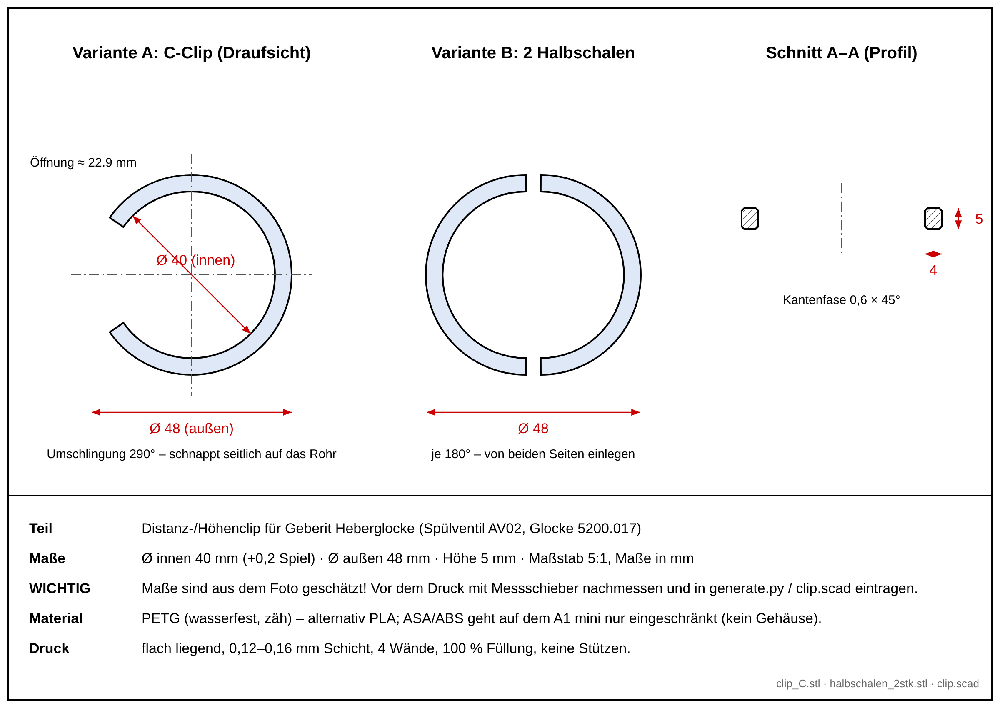

# Distanz-Clip für Geberit Heberglocke (AV02 / 5200.017) – Druckanleitung Bambu Lab A1 mini

## Dateien
| Datei | Inhalt |
|---|---|
| `clip_C.stl` | Variante A: C-Clip aus einem Teil, wird seitlich auf das Rohr geschnappt |
| `halbschalen_2stk.stl` | Variante B: zwei Halbschalen (wie im eBay-Angebot), ein Druckvorgang |
| `clip.scad` | Parametrisches Modell für OpenSCAD / MakerWorld „Parametric Model Maker" |
| `generate.py` | Erzeugt die STL-Dateien neu (nur Python nötig) |
| `zeichnung.svg/.png` | Technische Zeichnung |

## 1. Zuerst messen (wichtig!)
Die Maße (Ø innen 40, Ø außen 48, Höhe 5 mm) sind **aus dem Foto geschätzt**. Mit einem Messschieber messen:
1. **Ø innen** = Durchmesser des weißen Rohrs direkt unter dem Ring, wo der Clip sitzen soll.
2. **Ø außen** = Durchmesser des Rings darüber (der Clip sollte nicht breiter sein).
3. **Höhe** = Spalt, den der Clip ausfüllen soll (zwischen Ring und Gehäuse, siehe Pfeil).

Werte eintragen – entweder:
- **Ohne Programmierkenntnisse:** auf <https://makerworld.com> → „Parametric Model Maker" die Datei `clip.scad` hochladen, Werte ändern, „Generate" → als STL/3MF herunterladen bzw. direkt in Bambu Studio öffnen.
- **Oder** in OpenSCAD (kostenlos, openscad.org): `clip.scad` öffnen, oben die Zahlen ändern, F6 (Render), F7 (STL exportieren).
- **Oder** in `generate.py` oben die Zahlen ändern und `python3 generate.py` ausführen.

Tipp: Erst einen Testclip drucken (dauert nur ~10 min) und anprobieren. Sitzt er zu stramm → `spiel` auf 0,3–0,4 erhöhen; zu lose → 0 oder `innen_d` etwas kleiner.

## 2. In Bambu Studio importieren
1. **Bambu Studio** öffnen (kostenlos, bambulab.com). Beim ersten Start Drucker **A1 mini** und Düse **0,4 mm** wählen.
2. Oben links Drucker = *Bambu Lab A1 mini*, Platte = *Textured PEI Plate* (bzw. deine Platte).
3. **Datei → Importieren → 3MF/STL/… importieren** (Strg+I) und `clip_C.stl` oder `halbschalen_2stk.stl` auswählen – oder die Datei einfach ins Fenster ziehen.
4. Das Teil liegt automatisch flach auf der Platte (Ring liegt waagerecht – so lassen!). Falls nicht: Teil anklicken → Taste **F** („Auf Fläche legen") → untere Fläche anklicken.
5. Mehrere Ersatzteile? Rechtsklick → **Klonen** (z. B. 3 Stück) → Taste **A** (Anordnen).

## 3. Druckeinstellungen
| Einstellung | Wert | Wo |
|---|---|---|
| Filament | **PETG** (Bambu PETG HF/Basic) – wasserfest & zäh; PLA geht notfalls | links „Filament" |
| Prozess | **0.12 mm Fine** oder 0.16 mm Optimal | links „Prozess" |
| Wandlinien | **4** | Prozess → Festigkeit |
| Fülldichte | **100 %** | Prozess → Festigkeit |
| Stützstrukturen | **aus** | Prozess → Stützen |
| Brim | nicht nötig (bei PETG ggf. „Auto") | Prozess → Andere |

Bei PETG: Platte nicht mit Kleber vergessen bzw. auf Textured PEI drucken (glatte Platte braucht Kleberstift, sonst haftet PETG zu stark).

## 4. Slicen und drucken
1. Oben rechts **„Platte slicen"** klicken → Vorschau prüfen (Schichten sehen sauber aus, keine Stützen).
2. **„Drucken"** → Drucker per WLAN wählen → senden.
   Ohne WLAN: **„Exportieren → G-Code-Datei / Plattenschnitt exportieren"** auf microSD speichern, Karte in den A1 mini stecken und am Display starten.
   Alternativ per **Bambu Handy**-App aufs Handy.
3. Druckdauer ca. 10–20 min pro Clip.

## 5. Einbau
1. Wasser abstellen, Spülkasten leer spülen, Betätigungsplatte abnehmen und Heberglocke herausnehmen.
2. C-Clip seitlich auf das Rohr unter dem Ring drücken (schnappt ein) bzw. die zwei Halbschalen von beiden Seiten einlegen.
3. Glocke wieder einsetzen, Wasser aufdrehen, Funktion und Dichtheit prüfen.
