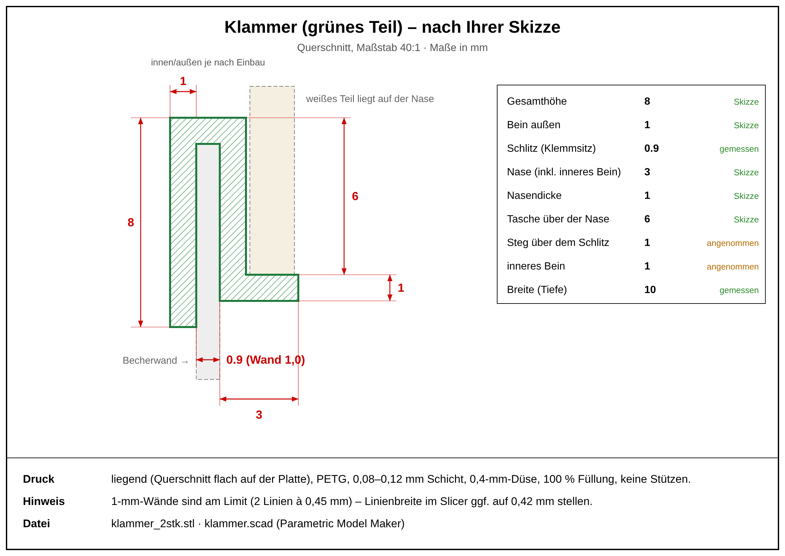

# Klammer (grünes Teil) – Geberit Heberglocke AV02 / 5200.017

Maße aus der Handskizze des Originals: umgedrehtes U mit 1-mm-Schlitz für die Becherwand,
unten innen eine Nase, auf der das weiße Teil in einer 6 mm hohen Tasche aufliegt.

## Dateien
- `klammer_2stk.stl` – 2 Klammern, druckfertig
- `klammer.scad` – alle Maße als Regler (MakerWorld Parametric Model Maker / OpenSCAD)
- `generate.py` / `skizze.py` – erzeugen STL und Skizze neu

## Maße (mm)
| Maß | Wert | Quelle |
|---|---|---|
| Gesamthöhe | 8 | Skizze |
| Bein außen | 1 | Skizze |
| Schlitz (Wand 1,0 mm) | 0,9 – Klemmsitz, damit die Klammer bei Bewegung nicht abrutscht | gemessen |
| Nase inkl. inneres Bein | 3 | Skizze |
| Nasendicke | 1 | Skizze |
| Tasche über der Nase | 6 | Skizze |
| Steg über dem Schlitz | 1 | angenommen |
| inneres Bein | 1 | angenommen |
| Breite (Tiefe) | 10 | gemessen |

## Drucken
1. `klammer_2stk.stl` in Bambu Studio importieren – liegt schon richtig (Querschnitt flach).
2. PETG, Schicht 0,08–0,12 mm, 100 % Füllung, keine Stützen.
3. 1-mm-Wände sind für die 0,4-mm-Düse knapp: Linienbreite der Wände ggf. auf 0,42 mm stellen.
4. Schlitz ist bewusst 0,9 mm (Klemmsitz auf der 1-mm-Wand). Geht die Klammer gar nicht drauf → `schlitz` auf 0,95 stellen; rutscht sie noch → 0,85.
